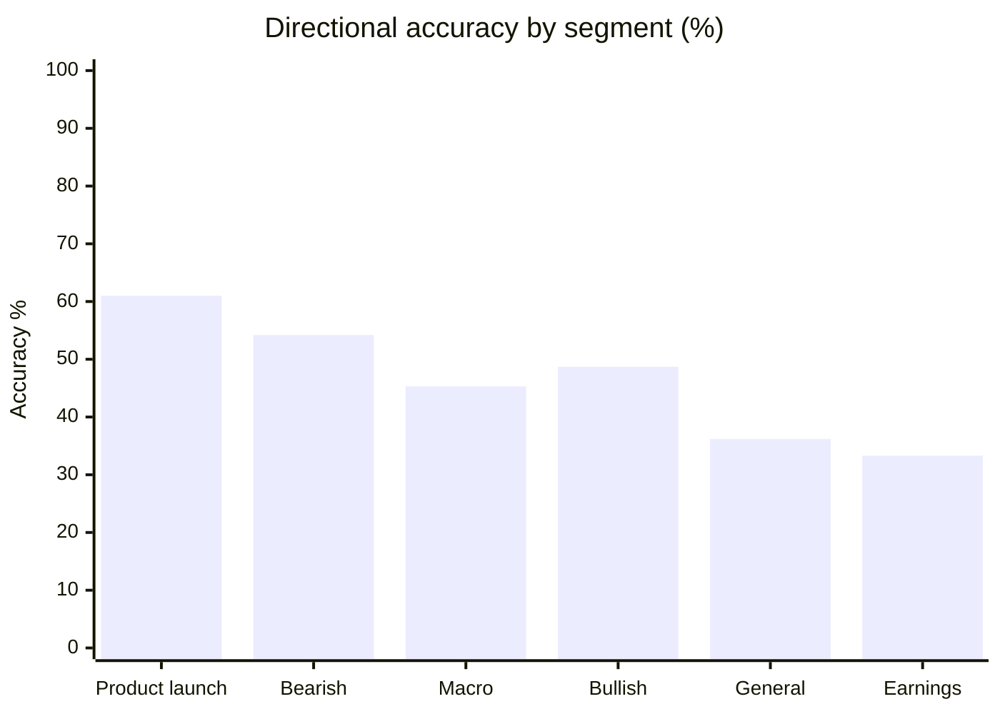
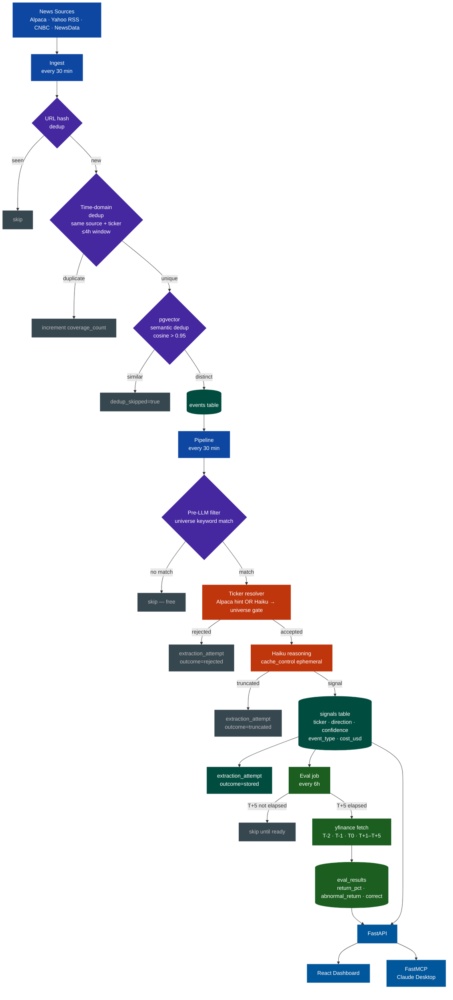
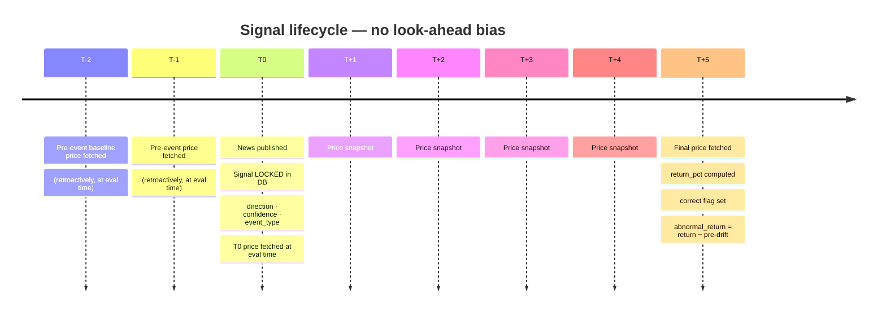

# NewsAlpha

Every day, thousands of financial news articles move stock prices. Most investors read the same headlines and form gut feelings. NewsAlpha asks a different question: **can an LLM reliably predict which direction a stock will move after a news event — and can we actually measure whether it's right?**

This is a full end-to-end answer to that question, built and measured in production.

---

## 🎯 The Problem

Financial news creates noisy, high-volume signal. The conventional wisdom is split: either "the market is efficient and you can't extract alpha from public news," or "sentiment analysis works" — but almost nobody builds a system that rigorously measures both the prediction *and* the outcome at scale.

The two failure modes:
1. **Vibes-based evaluation** — "the model said bullish and the stock went up, seems right!" No baseline, no sample size, no segmentation.
2. **Look-ahead bias** — accidentally using post-reaction prices as the input, making the signal look much better than it is.

---

## 📊 Results

First full eval wave: **Sep 8–17, 2026** · **656 signals evaluated** at T+5 market close.



| Segment | n | Accuracy | Read |
|---------|---|----------|------|
| Product launch | 118 | **61.0%** | Discrete, unambiguous — market hadn't priced it |
| Bearish | 120 | **54.2%** | Model reads downside catalysts better than upside |
| Macro | 106 | 45.3% | Noise zone — market-wide events too diffuse |
| Bullish | 312 | 48.7% | Near coin-flip — positive sentiment already priced in |
| General | 348 | 36.2% | Anti-signal territory |
| Earnings | 84 | **33.3%** | Strong anti-signal — flip it for ~67% ("sell the news") |
| Neutral | 224 | 25.4% | Expected — LLM struggles to call flat correctly |

Overall accuracy is **41.8%** — below random. But segmented, the picture is more useful: product launches have a real edge, earnings signals should be inverted, and bearish calls outperform bullish by 5.5 percentage points.

Information coefficient (IC): **0.035** — weak positive directional correlation (n=432 directional signals). Profit factor: **1.06** — dragged down by the general/earnings buckets; product_launch + bearish alone would show a much stronger ratio.

Avg abnormal return: **+0.97%** (T0→T5 return minus T-2→T0 pre-event drift).

Cost: **$0.0062 per signal** using Claude Haiku 4.5 with prompt caching.

---

## ⚙️ What We Built

**Signals are locked at T0 before the T+5 price is ever fetched.** The pipeline is forward-only by construction — look-ahead bias is architecturally impossible, not just avoided by convention.

The pipeline ingests financial news from 4 sources, deduplicates at three layers (URL hash, time-domain wire-service suppression, pgvector semantic similarity), then runs each story through a LangGraph chain: pre-filter → ticker resolution against a curated 100-stock universe → Claude Haiku reasoning → structured output. Five calendar days later, the eval job fetches the full price curve and scores the prediction.

### 🔄 Pipeline



### ⏱️ Eval Design

The signal (direction, confidence) is written at T0 and never modified. Prices are fetched days later — the two never touch until evaluation:



---

## 🧠 Architecture

**LangGraph chain** — two nodes: ticker resolver (Alpaca hint fast-path, or LLM → validate against universe) and reasoning node (structured output via tool call). Every call traced in Langfuse.

**Universe gate** — 100 curated tickers (S&P 500 megacaps, no utilities/REITs/commodity E&P). Signals outside the universe are rejected — no hallucinated tickers reach the DB.

**Cost tracking** — every LLM call writes to `extraction_attempts`, including rejections. Nothing is invisible in the spend report.

**Abnormal return** — T0→T5 raw return minus the T-2→T0 pre-event drift. Isolates the news effect from pre-existing momentum.

**Stack:** FastAPI + SQLAlchemy 2.0 async + PostgreSQL 16 + pgvector · LangGraph + Claude Haiku 4.5 · Langfuse (self-hosted) · APScheduler · yfinance · React + TypeScript + Vite · FastMCP

---

## 🚀 Run It

```bash
git clone https://github.com/yehomak/NewsAlpha
cp .env.example .env        # ANTHROPIC_API_KEY + ALPACA_API_KEY
docker compose up
```

App → `localhost:8000` · Dashboard → `localhost:5173` · Langfuse → `localhost:3000`

```bash
# Trigger manually
curl -X POST localhost:8000/ingestion/trigger
curl -X POST localhost:8000/signals/trigger
curl -X POST localhost:8000/eval/trigger

# Check results
curl localhost:8000/eval/summary
```

---

## 📁 Dive Deeper

- **[`app/pipeline/`](app/pipeline/)** — LangGraph chain: nodes, state, runner, universe
- **[`app/eval/`](app/eval/)** — pricer, T0 anchor, 8-point curve, abnormal return
- **[`app/api/routes/`](app/api/routes/)** — FastAPI endpoints
- **[`dashboard/src/`](dashboard/src/)** — React sections mapped to pipeline stages
- **[`CLAUDE.md`](CLAUDE.md)** — full architecture reference
